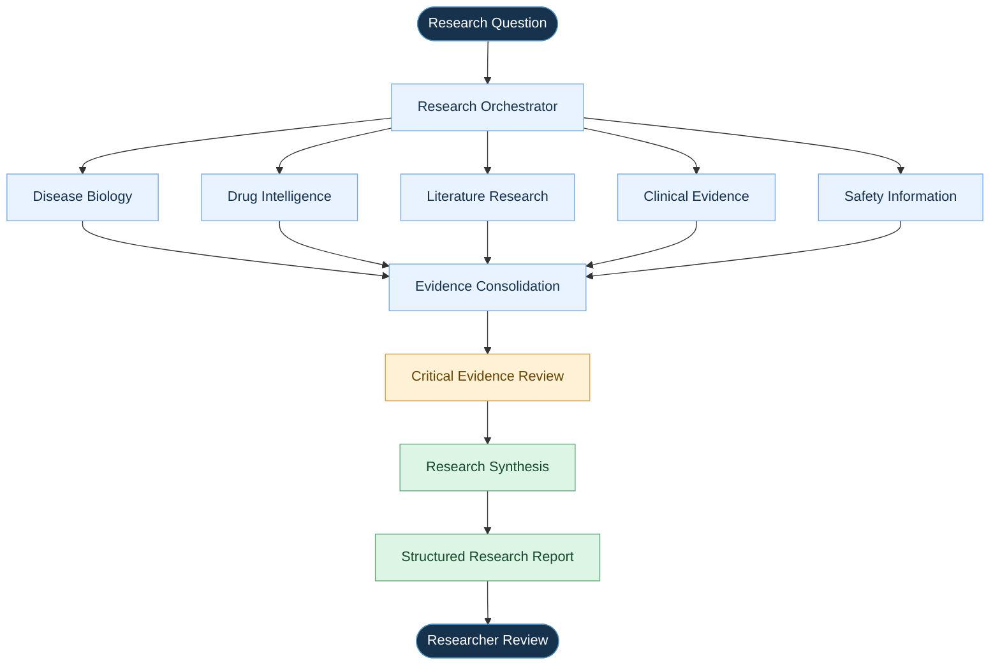
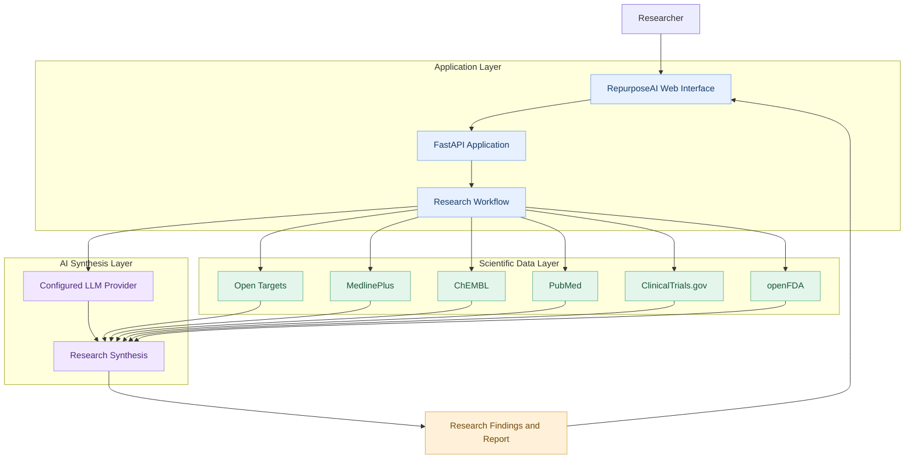
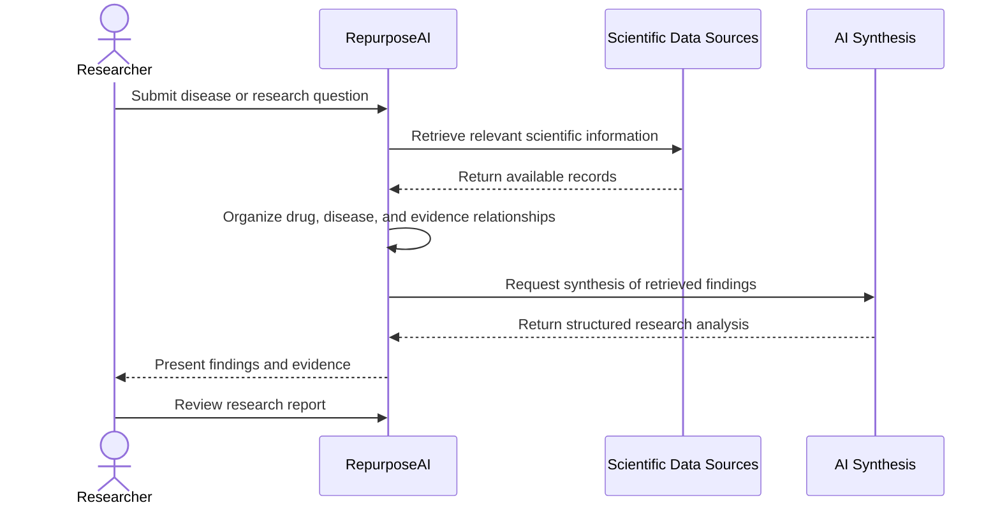

# 🧬 RepurposeAI
### Agentic AI for Drug Repurposing Intelligence

<p align="center">
  <strong>From existing molecules to new therapeutic hypotheses.</strong>
</p>

<p align="center">
  An AI-powered life-sciences research platform that connects disease biology, drug intelligence, scientific literature, clinical evidence, and safety data to investigate potential drug-repurposing opportunities.
</p>

<p align="center">
  <a href="https://github.com/Senior19/Repurpose-AI">GitHub Repository</a> •
  <a href="#-features">Features</a> •
  <a href="#-architecture">Architecture</a> •
  <a href="#-getting-started">Getting Started</a>
</p>

---

## 🔬 Overview

**RepurposeAI** is a multi-agent AI research platform designed to help life-sciences researchers investigate whether existing drugs could have potential applications in other diseases.

Drug repurposing can reduce the need to start from an entirely new molecule. However, investigating a potential new use requires researchers to connect information from multiple sources, including disease-associated targets, drug mechanisms, scientific publications, clinical trials, and safety information.

RepurposeAI brings these research activities together in a unified workflow.

Instead of relying on a single LLM to generate an answer, the platform combines public scientific data sources with AI-assisted research and synthesis to produce structured, evidence-oriented research insights.

> **Core principle:** AI should help researchers investigate scientific hypotheses, not replace scientific validation.

## 🎯 Problem Statement

Drug-repurposing research is often fragmented across scientific databases, publications, and clinical-trial registries.

Researchers may need to:

- Identify disease-associated genes, proteins, and biological pathways.
- Discover existing drugs associated with relevant molecular targets.
- Review scientific publications and experimental findings.
- Investigate available clinical evidence.
- Examine relevant safety information.
- Identify contradictory findings and unresolved research questions.

Manually connecting these pieces can be time-consuming.

**RepurposeAI addresses this challenge by organizing the investigation into a structured, multi-agent research workflow.**

## ✨ Features

| Feature | Description |
|---|---|
| 🧬 Disease Intelligence | Explore disease biology, associated targets, genes, proteins, and pathways using available data. |
| 💊 Drug Intelligence | Investigate existing drugs, their known indications, mechanisms, and drug-target relationships. |
| 📚 Literature Intelligence | Retrieve and examine relevant scientific publications. |
| 🏥 Clinical Evidence | Explore relevant clinical trials and available human evidence. |
| ⚕️ Safety Intelligence | Surface relevant safety information from available public sources. |
| 🔎 Evidence Analysis | Organize research findings and highlight limitations or conflicting evidence where identified. |
| 🕸️ Knowledge Exploration | Connect diseases, drugs, targets, pathways, and supporting evidence. |
| 🤖 Multi-Agent Synthesis | Use an LLM-backed workflow to synthesize research findings into a structured report. |

*Feature outputs depend on the information available from the underlying data sources and the configured AI provider.*

## 🧠 How It Works

The research process follows a simple principle:

**Research Question → Data Retrieval → Specialized Analysis → Evidence Synthesis → Research Report**



### Research workflow

1. **Define the objective:** The user provides a disease or research question.
2. **Retrieve relevant information:** The application gathers data from available scientific sources.
3. **Investigate relationships:** Relevant drug, disease, literature, clinical, and safety information is examined.
4. **Evaluate findings:** Available evidence is organized to support further investigation and identify limitations.
5. **Synthesize results:** The AI workflow produces a structured research brief for human review.

## 🏗️ Architecture

RepurposeAI combines a Python backend, public scientific data sources, and optional LLM-powered synthesis.



### Technology stack

| Component | Technology |
|---|---|
| Backend | Python |
| API framework | FastAPI |
| Scientific data | Public life-sciences APIs |
| AI synthesis | Groq or Anthropic, configured through environment variables |
| Configuration | Environment variables and Streamlit configuration |
| Application entry point | `repurposeai/backend/main.py` |

*The configured AI provider is optional for evidence-exploration functionality; LLM-backed multi-agent synthesis requires a supported API key.*

## 🔌 Scientific Data Sources

RepurposeAI integrates with public scientific resources to retrieve relevant research information.

| Data source | Primary purpose |
|---|---|
| [Open Targets](https://platform.opentargets.org/) | Explore target-disease associations and target biology. |
| [MedlinePlus](https://medlineplus.gov/) | Retrieve accessible health and disease information. |
| [ChEMBL](https://www.ebi.ac.uk/chembl/) | Explore bioactive molecules, drug information, and biological activity. |
| [PubMed](https://pubmed.ncbi.nlm.nih.gov/) | Discover biomedical literature and publications. |
| [ClinicalTrials.gov](https://clinicaltrials.gov/) | Investigate registered clinical studies. |
| [openFDA](https://open.fda.gov/) | Retrieve available public drug and safety-related information. |

The sources provide complementary perspectives on diseases, molecules, research findings, clinical development, and safety.

Coverage and available fields vary by source. A missing result does not necessarily mean that no relevant evidence exists.

## 🚀 Getting Started

### Prerequisites

- Python installed on your system.
- Git.
- Internet access for public scientific data retrieval.
- An API key from a supported LLM provider for AI-powered multi-agent synthesis.

### 1. Clone the repository

```bash
git clone https://github.com/Senior19/Repurpose-AI.git
cd Repurpose-AI
```

### 2. Navigate to the backend

```bash
cd repurposeai/backend
```

### 3. Create a virtual environment

**Windows PowerShell**

```powershell
python -m venv .venv
.\.venv\Scripts\Activate.ps1
```

**macOS / Linux**

```bash
python3 -m venv .venv
source .venv/bin/activate
```

### 4. Install dependencies

```bash
python -m pip install -r requirements.txt
```

### 5. Configure the AI provider

Set the API key for your chosen provider.

**PowerShell:**

```powershell
$env:GROQ_API_KEY = "your-groq-api-key"
```

Alternatively, configure Anthropic:

```powershell
$env:ANTHROPIC_API_KEY = "your-anthropic-api-key"
$env:REPURPOSEAI_PROVIDER = "anthropic"
```

For the Groq provider, you can optionally specify a model:

```powershell
$env:REPURPOSEAI_PROVIDER = "groq"
$env:REPURPOSEAI_MODEL = "your-supported-model-id"
```

Use a model supported by your selected provider and configured application. Never commit API keys to GitHub.

Evidence-exploration functionality can operate without an AI key, while multi-agent synthesis requires a configured provider.

### 6. Start the application

```bash
python -m uvicorn main:app --reload --port 8000
```

Open the application in your browser:

**http://localhost:8000**

For the repository's Windows startup script, you can also use:

```powershell
./run.ps1
```

## ☁️ Deployment

The repository is configured for deployment through Streamlit Community Cloud using its FastAPI application entry point.

| Setting | Value |
|---|---|
| Repository | `Senior19/Repurpose-AI` |
| Branch | `main` |
| Main file path | `repurposeai/backend/main.py` |
| Requirements file | `repurposeai/backend/requirements.txt` |

Add required API keys through the deployment platform's secrets settings. Do not store credentials in source code or commit them to the repository.

## 🧪 Example Use Case

Imagine a researcher wants to investigate potential drug-repurposing hypotheses for a disease.

The research process might look like this:



The resulting report can help the researcher examine:

- Potential drug-disease relationships.
- Relevant biological mechanisms and targets.
- Supporting scientific publications.
- Available clinical-trial information.
- Relevant safety considerations.
- Evidence limitations and unanswered questions.

The report should be treated as a starting point for further investigation, not as proof that a drug is effective for a new indication.

## 🛡️ Responsible AI and Limitations

RepurposeAI is designed for scientific exploration and research support.

- **Not a clinical tool:** It does not diagnose diseases or recommend treatments.
- **Evidence matters:** AI-generated hypotheses require verification against the original sources.
- **Uncertainty is expected:** Scientific evidence can be incomplete, conflicting, or unavailable.
- **Source coverage is limited:** Public APIs may omit relevant studies or provide incomplete records.
- **Human oversight is essential:** Researchers must independently evaluate findings before making scientific or development decisions.
- **Safety is not guaranteed:** Existing drug safety information does not establish safety or effectiveness for a new indication.

## 🔭 Future Possibilities

Potential areas for further development include:

- More advanced drug-disease knowledge graphs.
- Improved evidence grading and citation verification.
- Better detection of conflicting research findings.
- Research project history and persistent investigation context.
- Candidate comparison and customizable evidence criteria.
- Automated evaluation of agent outputs.
- More robust orchestration, retries, and workflow observability.

These are potential extensions, not claims that every capability is already implemented.

## 👨‍💻 Project Motivation

RepurposeAI was built to explore the intersection of **Agentic AI, bioinformatics, and life-sciences research**.

The project explores how AI-driven workflows can help organize scientific information, investigate biological relationships, and produce structured research insights while preserving transparency and human oversight.

It also serves as a practical exploration of AI-assisted development, scientific API integration, research workflows, and evidence-oriented AI applications.

## ⚠️ Disclaimer

RepurposeAI is an experimental research prototype intended for educational and exploratory purposes. It is not a medical device, clinical decision-support system, or substitute for professional scientific, medical, or regulatory evaluation.

Any potential drug-repurposing hypothesis must undergo appropriate scientific validation and relevant preclinical, clinical, and regulatory assessment.

---

<p align="center">
  <strong>RepurposeAI</strong><br>
  Connecting scientific evidence to investigate new therapeutic possibilities.
</p>
