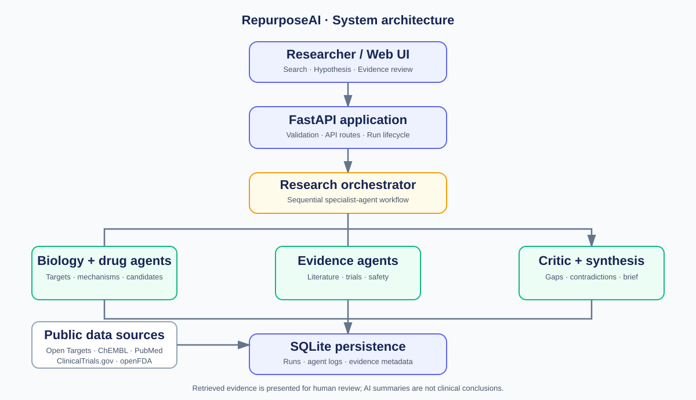
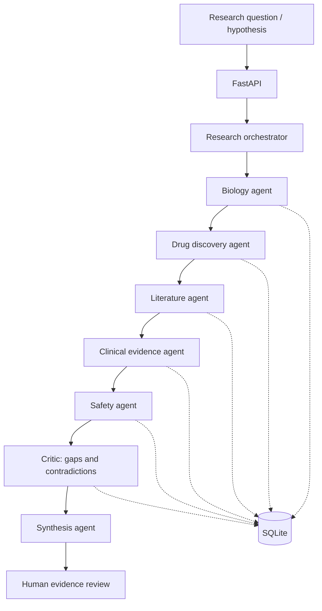

# RepurposeAI

**An AI-assisted research workspace for exploring drug-repurposing hypotheses.**

RepurposeAI combines public life-sciences databases with a sequential multi-agent workflow. It helps researchers organize disease biology, drug mechanisms, publications, clinical-trial registrations, and drug-label information into a traceable research brief.

> **Research prototype:** It generates research leads, not treatment recommendations or validated clinical conclusions.

## What it does

- Explore disease-associated targets using Open Targets.
- Retrieve drug mechanisms and indication records from ChEMBL.
- Search biomedical publications through PubMed.
- Find registered studies through ClinicalTrials.gov.
- Retrieve public drug-label information from openFDA.
- Run specialist agents for biology, drug discovery, literature, clinical evidence, safety, critique, and synthesis.
- Review supporting/contradictory evidence and recorded knowledge gaps.

## Product preview

Architecture diagram:



Real application screenshots are being added in [`docs/SCREENSHOTS.md`](docs/SCREENSHOTS.md). They should be captured from a running instance with real API results; no mock screenshots or fabricated results are included.

## How it works



The pipeline is sequential. Agents retrieve records from external sources; the language model organizes and summarizes supplied material. A model-generated explanation is not itself a source.

## Evidence provenance

Evidence records retain available source identifiers and metadata, including:

- PubMed PMID and DOI (when returned by PubMed).
- ClinicalTrials.gov NCT identifier and study type.
- ChEMBL compound identifier and source URL.
- openFDA label record identifier and source URL.
- Publication/trial dates and retrieval timestamps where available.

Open each source link and verify the original record before relying on a claim. Missing records are recorded as knowledge gaps, not proof that evidence does not exist.

## Data sources

| Source | Purpose |
|---|---|
| [Open Targets](https://platform.opentargets.org/) | Disease-target associations |
| [ChEMBL](https://www.ebi.ac.uk/chembl/) | Compounds, mechanisms and indications |
| [PubMed](https://pubmed.ncbi.nlm.nih.gov/) | Biomedical publication metadata |
| [ClinicalTrials.gov](https://clinicaltrials.gov/) | Registered clinical studies |
| [openFDA](https://open.fda.gov/) | Public drug-label information |
| [MedlinePlus](https://medlineplus.gov/) | Plain-language health-topic information |

## Tech stack

Python · FastAPI · SQLite · JavaScript · HTML/CSS · Groq or Anthropic · public scientific APIs

## Run locally

From the repository root:

**Windows PowerShell**

```powershell
cd repurposeai/backend
py -m venv .venv
.\.venv\Scripts\Activate.ps1
python -m pip install -r requirements.txt
Copy-Item ..\..\.env.example .env
```

**macOS / Linux**

```bash
cd repurposeai/backend
python3 -m venv .venv
source .venv/bin/activate
python -m pip install -r requirements.txt
# Optional: use ../../.env.example as a reference for variable names.
```

Set the provider variables in the same terminal before starting the server. For example, in PowerShell use `$env:GROQ_API_KEY="your-key"` and `$env:REPURPOSEAI_PROVIDER="groq"`. On macOS/Linux use `export GROQ_API_KEY="your-key"` and `export REPURPOSEAI_PROVIDER="groq"`. For Anthropic, set `ANTHROPIC_API_KEY` and `REPURPOSEAI_PROVIDER=anthropic`. The root `.env.example` documents the variable names; the app does not automatically load `.env` files. Never commit credentials.

Start the API and web app:

```bash
python -m uvicorn main:app --reload --port 8000
```

Open http://localhost:8000.

## Example research walkthrough

See [`docs/RESEARCH_WALKTHROUGH.md`](docs/RESEARCH_WALKTHROUGH.md) for a reproducible investigation protocol and a template for recording run IDs, source identifiers, contradictory evidence, and knowledge gaps. It intentionally does not claim that any example drug treats a disease.

## Repository layout

```text
Repurpose-AI/
├── .github/workflows/       # CI
├── docs/
│   ├── architecture.svg
│   ├── RESEARCH_WALKTHROUGH.md
│   └── SCREENSHOTS.md
└── repurposeai/
    ├── backend/             # FastAPI, agents, tools, SQLite
    └── frontend/            # Web interface
```

## Limitations

- Agents currently run sequentially; this is not a distributed worker system.
- Some literature triage uses publication titles and metadata, not full text.
- External API coverage, freshness, and availability vary.
- Study registration does not imply trial success.
- Mechanistic associations do not establish therapeutic efficacy.
- Confidence labels are model assessments, not calibrated clinical probabilities.
- SQLite is intended for a single-instance prototype, not high-concurrency multi-user production.

## Safety

RepurposeAI is an experimental research tool for educational and exploratory use. It is not a medical device or clinical decision-support system. All findings must be independently checked against primary sources and reviewed by qualified experts before scientific, clinical, or development use.

---

Built to explore the intersection of agentic AI, bioinformatics, and drug discovery.
